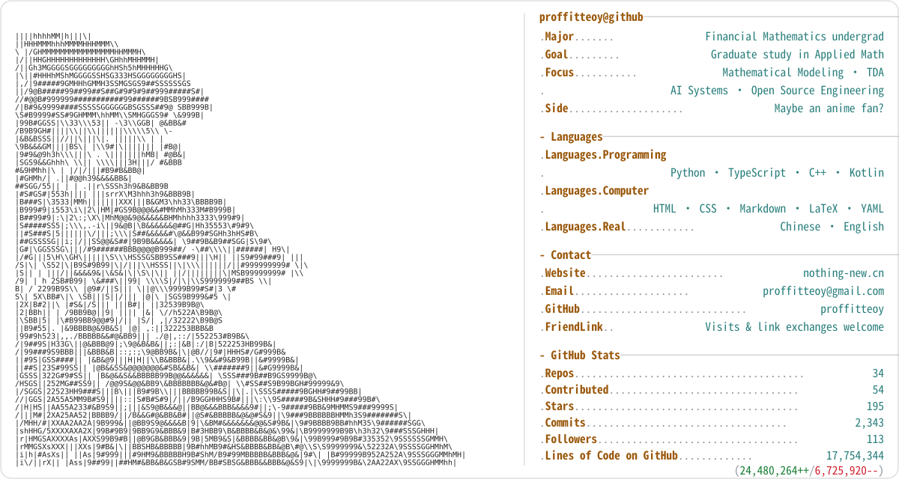

<a href="https://nothing-new.cn/">
  <picture>
    <source media="(prefers-color-scheme: dark)" srcset="https://raw.githubusercontent.com/proffitteoy/proffitteoy/main/dark_mode.svg?v=20261119-profile">
    
  </picture>
</a>

## Hi, I'm Xuanliang Li 👋

I'm a third-year mathematics undergraduate focused on data science and machine learning engineering, with over five years of programming experience. I enjoy breaking complex problems down into simple mathematical models and turning them into interpretable software solutions. I believe in the open-source community and actively contribute to its development.

### 👺 About Me

- I work on machine learning problems such as prediction, anomaly detection, and classification in open-source projects.
- I lead my university's AI and quantitative investment organizations, with a focus on building academic platforms.
- My current focus is topological data analysis, with several papers in pure mathematics, applied mathematics, and computer science.
- I author and collaborate on a range of topological data analysis libraries.

> [!NOTE]
> I’m always glad to connect about mathematics, TDA, AI, and open-source projects. I share notes on [my blog](https://nothing-new.cn/) and enjoy exchanging ideas or blog links. Reach me by [email](mailto:proffitteoy@gmail.com).

## Projects

<table>
<tr>
<td width="25%" valign="top">

RESEARCH · PAPER SUBMITTED 
<a href="https://github.com/proffitteoy/early-rumor-propagation-tda"><strong>early-rumor-propagation-tda</strong></a> 
Topological feature construction and persistent homology analysis of early rumor propagation trees.  
<code>TDA</code> <code>Research</code>

</td>
<td width="25%" valign="top">

RESEARCH · ARCHIVED 
<a href="https://github.com/proffitteoy/anime-avatar-runtime"><strong>anime-avatar-runtime</strong></a> 
Research on continuous generation, state persistence, and failure recovery for anime characters.  
<code>Python</code> <code>Video Generation</code>

</td>
<td width="25%" valign="top">

RESEARCH · MANUSCRIPT IN PROGRESS 
<a href="https://github.com/proffitteoy/homology-operator"><strong>homology-operator</strong></a> / <strong>homology-operator-lab</strong> 
Boundary-matrix-driven homology operators combining persistent homology and geometric information.  
<code>TDA</code> <code>F₂ Homology</code>
</td>
<td width="25%" valign="top">

RESEARCH · UNDER EXTERNAL REVIEW 
<a href="https://github.com/proffitteoy/Topp"><strong>Topp</strong></a> 
A high-performance Python library for computing bottleneck and Wasserstein distances in topological data analysis.  
<code>TDA</code> <code>Python</code> <code>Exact Matching</code>

</td>
</tr>
<tr>
<td width="25%" valign="top">

OPEN SOURCE CONTRIBUTION 
<a href="https://github.com/open-ani/animeko"><strong>open-ani/animeko</strong></a> 
Development of CNN-based CAPTCHA recognition algorithms.  
<code>Kotlin Multiplatform</code> <code>Android</code>

</td>
<td width="50%" colspan="2" valign="middle" align="center">

</td>
<td width="25%" valign="top">

OPEN SOURCE CONTRIBUTION 
<a href="https://github.com/GUDHI/gudhi-devel"><strong>GUDHI/gudhi-devel</strong></a> 
Correctness fixes and cross-platform validation for core mathematical algorithms.  
<code>C++</code> <code>Bottleneck Distance</code> <code>Python</code>

</td>
</tr>
<tr>
<td width="25%" valign="top">

AI WORKBENCH 
<a href="https://github.com/proffitteoy/Iris-Terminal"><strong>Iris-Terminal</strong></a> 
A local-first AI4MATH workbench.  
<code>Local-first</code> <code>Research Workspace</code>

</td>
<td width="25%" valign="top">

CAMPUS COMPETITION UI 
<a href="https://github.com/gduf-community/ai-data-competitions-ui"><strong>ai-data-competitions-ui</strong></a> 
A college-level service website for student competitions.  
<code>Next.js</code> <code>React</code>

</td>
<td width="25%" valign="top">

TDA LIBRARY 
<a href="https://github.com/Aequiludium/cocycle-rs"><strong>cocycle-rs</strong></a> 
A pure Rust library for topological data analysis, supporting persistent homology and persistence diagram distances.  
<code>Rust</code> <code>TDA</code> <code>Persistence</code>

</td>
<td width="25%" valign="top">

WRITING RESEARCH 
<a href="https://github.com/proffitteoy/Mathematician-Humanizer"><strong>Mathematician-Humanizer</strong></a> 
A skill for mathematicians to make AI-generated writing sound more natural.  
<code>Python</code> <code>Style Modeling</code>

</td>
</tr>
</table>
